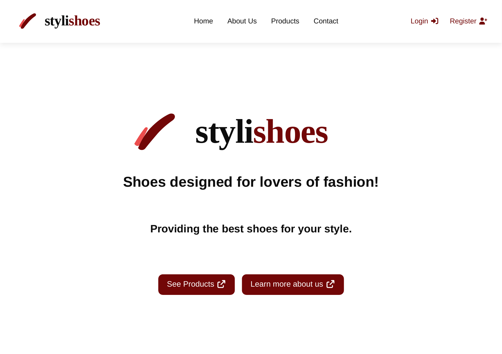
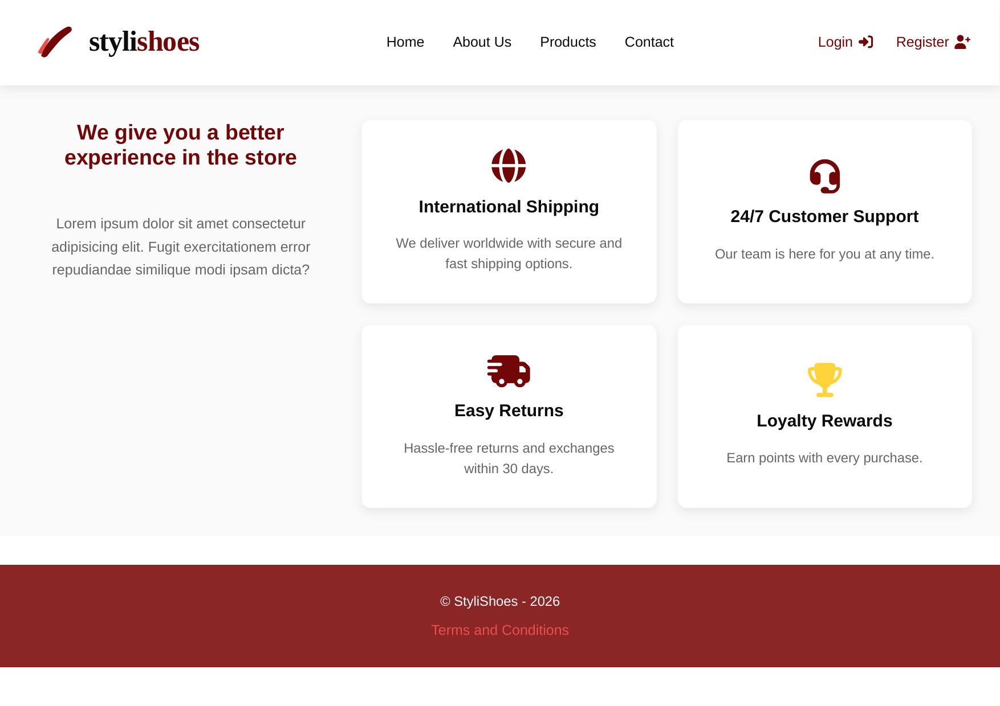
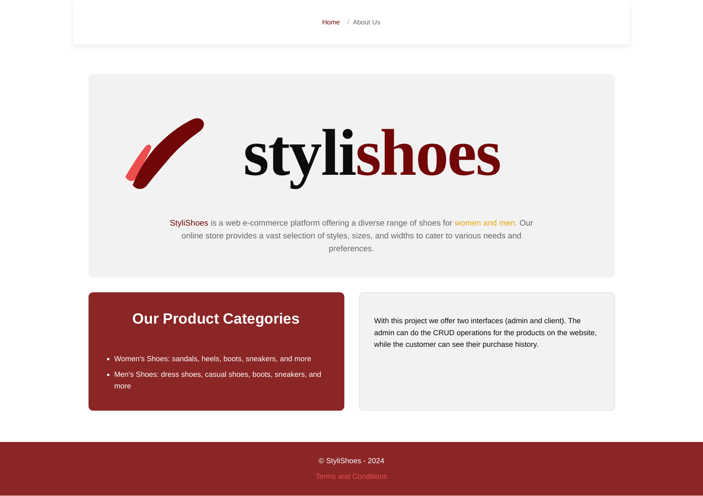
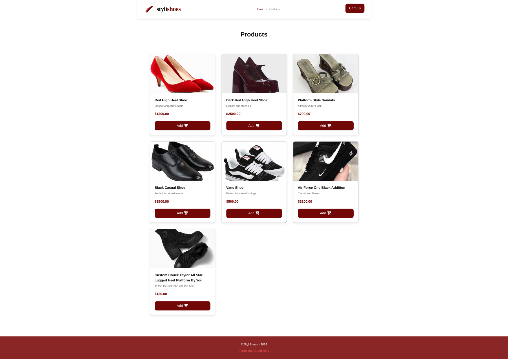
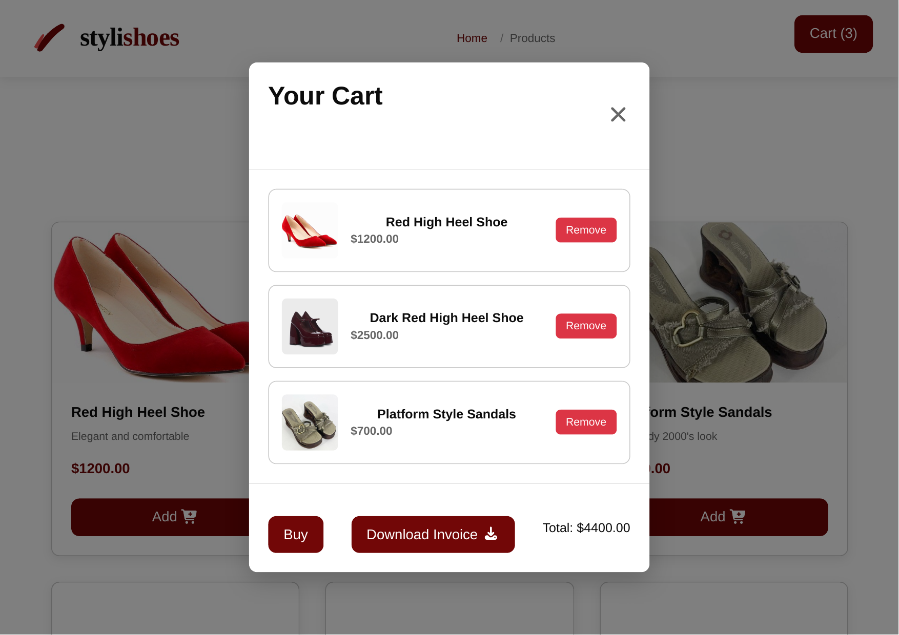
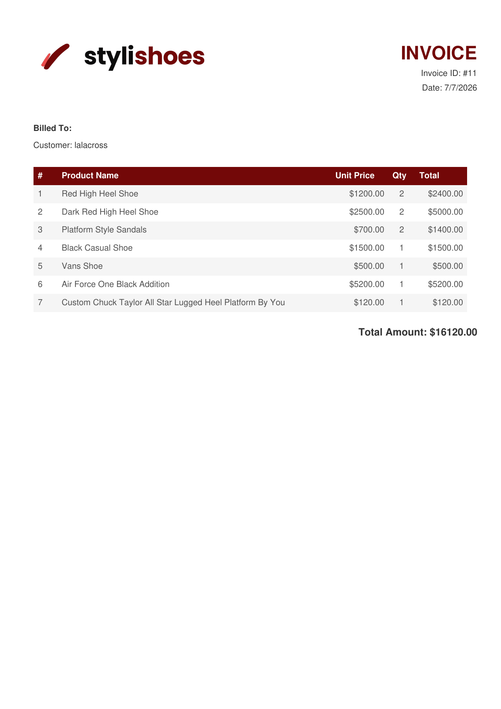
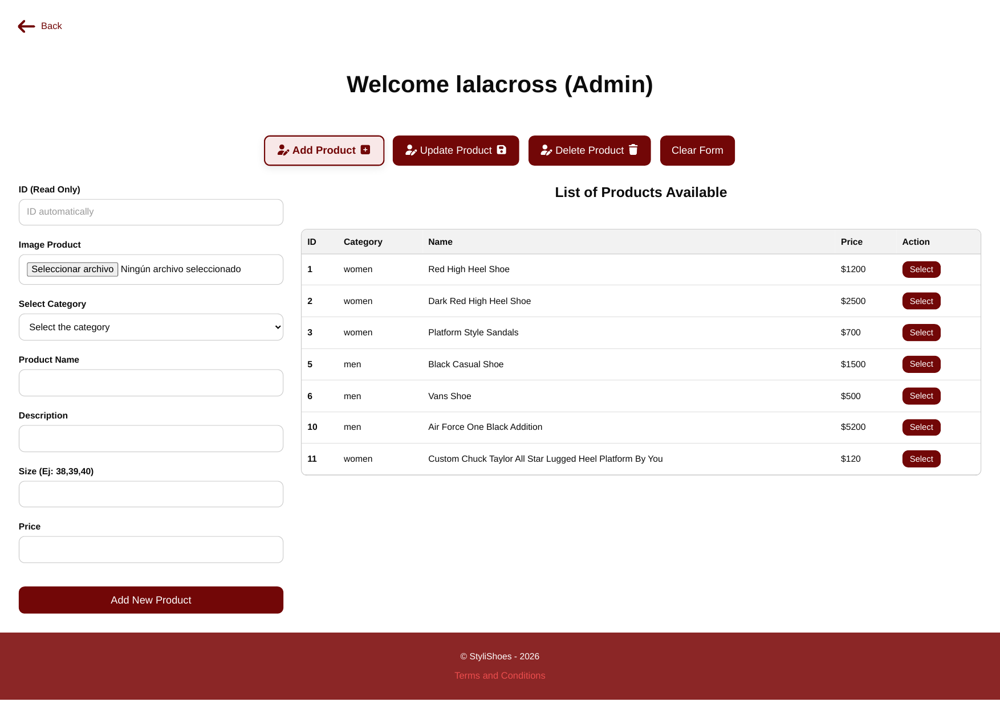
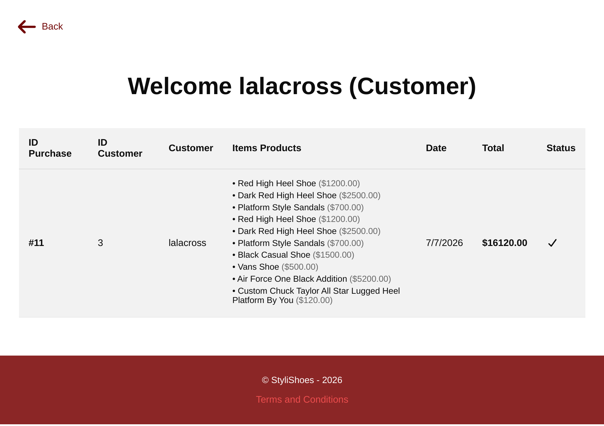
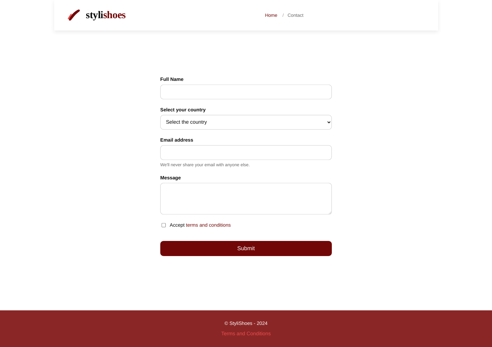

# 👟 StyliShoes

Una tienda virtual de calzado desarrollada para ofrecer una experiencia de compra moderna, rápida e intuitiva. Los usuarios pueden explorar productos, visualizar sus detalles y realizar compras desde una interfaz atractiva y responsive.

## 📖 Descripción

StyliShoes es un proyecto web enfocado en la venta de calzado, diseñado con una interfaz moderna y amigable para el usuario.

Su objetivo es facilitar la navegación entre productos y brindar una experiencia de compra agradable desde cualquier dispositivo.

## 📚 Documentación
📋 Tabla de contenido
1. [Introducción](./docs/Introducción.md): Acerca del proyecto.
2. [Requisitos](./docs/Requisitos.md): Requisitos antes de instalar el proyecto.
3. [Instalación](./docs/Instalación.md): Instalación y despliegue del proyecto.
4. [APIs](./docs/Endpoints.md): APIs, Endpoints y Módulos.
5. [Arquitectura](./docs/Arquitectura.md): Arquitectura y diseño de base de datos.
6. [Reportes de optimización](./docs/perfomances/): Archivos en formato PDF acerca del rendimiento y optimización del proyecto.

## ✨ Características

- 🛍️ Catálogo de productos.
- 📱 Diseño responsive.
- 🛒 Carrito de compras.
- ❤️ Interfaz moderna y limpia.
- ⚡ Navegación rápida.


## 🚀 Instalación

1. Clona el repositorio.

```bash
git clone https://github.com/daridjcm/StyliShoes.git
```

2. Ingresa al proyecto.

```bash
cd StyliShoes
```

3. Instala dependencias y ejecuta el servidor.
```bash
bun install & bun run server.js
```


## 💻 Uso

Explora el catálogo de productos, navega por la tienda utilizando el menú principal y disfruta de su navegación intuitiva.


## 📷 Capturas de pantalla

### Página principal



### Sobre nosotros


### Catálogo


### Carrito de compras


### Facturas (al descargar en PDF)


### Interfaz del admin


### Interfaz del usuario


### Contacto


## 📁 Estructura del proyecto
```
└── 📁StyliShoes
    └── 📁docs
        └── 📁images
            └── 📁website
                └── 📁PDF
                    ├── About Us - StyliShoes.pdf
                    ├── Admin - StyliShoes.pdf
                    ├── Cart - StyliShoes.pdf
                    ├── Client - StyliShoes.pdf
                    ├── Contact - StyliShoes.pdf
                    ├── Home - StyliShoes.pdf
                    ├── invoice_11.pdf
                    ├── Products - StyliShoes.pdf
                └── 📁PNG
                    ├── aboutus-1.png
                    ├── admin-1.png
                    ├── cart-1.png
                    ├── client-1.png
                    ├── contact-1.png
                    ├── home-1.png
                    ├── home-2.png
                    ├── invoice-1.png
                    ├── products-1.png
            ├── diagramaDB.png
        └── 📁perfomances
            ├── desktop lighthouse.pdf
            ├── mobile lighthouse.pdf
        ├── Arquitectura.md
        ├── Endpoints.md
        ├── Instalación.md
        ├── Introducción.md
        ├── Requisitos.md
    └── 📁server
        └── 📁controllers
            ├── auth.controller.js
            ├── cart.controller.js
            ├── dashboard.controller.js
            ├── forms.controller.js
            ├── product.controller.js
        ├── database.js
        ├── index.js
    └── 📁src
        └── 📁images
            └── 📁logo
                ├── stylishoes-imagotype.png
                ├── stylishoes-imagotype.svg
                ├── stylishoes-isotype.png
                ├── stylishoes-isotype.svg
            ├── af1-force.jpeg
            ├── black-shoes.jpeg
            ├── cherry-heels.jpeg
            ├── heart-heleed.jpeg
            ├── product_11.jpeg
            ├── product_12.jpeg
            ├── product_1782109171717.jpeg
            ├── red-heels.jpeg
            ├── vans-shoes.jpeg
        └── 📁pages
            ├── aboutUS.html
            ├── contact.html
            ├── dashboard.html
            ├── login.html
            ├── products.html
            ├── register.html
            ├── terms_conditions.html
        └── 📁utils
            ├── products.json
        ├── styles.css
    ├── .env
    ├── .env.example
    ├── .gitignore
    ├── bun.lock
    ├── index.html
    ├── package.json
    ├── README.md
    └── server.js
```

## 📄 Licencia
Este proyecto fue desarrollado con fines académicos y de aprendizaje.