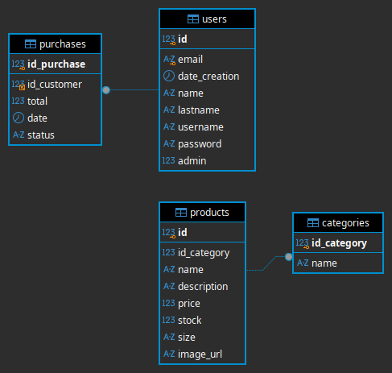

# Arquitectura
Stacks tecnológicos:
- Cliente: React, Vite, HTML y CSS
- Servidor: Bun, JavaScript y TypeScript
- Persistencia: MariaDB y MySQL2
- Autenticación: JWT

## Servidor
Cada capa tiene una sola responsabilidad (SRP) y solo habla con la capa de abajo:

```text
server.js                 Tabla de rutas + archivos estáticos (SPA)
 └── controllers/         HTTP: leen la petición, validan y responden (lanzan HttpError)
      └── services/       Lógica de negocio: auth (hash + JWT), facturas PDF, imágenes
           └── repositories/   Único lugar con SQL (Product, Purchase, User)
                └── database.ts    Pool MySQL + helpers query() / run()
 lib/                     Utilidades compartidas: http.js (json, HttpError, safely), paths.js
 models/                  Tipos TypeScript de las entidades
```

- Los errores se manejan en un solo punto (`safely` en `lib/http.js`): los controladores lanzan `HttpError(status, mensaje)` y el router lo convierte en JSON.
- Los controladores no ejecutan SQL; los repositorios no conocen HTTP.

## Cliente (`src/`)
```text
main.jsx → App.jsx           Router: ruta → página (sin dependencias extra)
routes.js                    Única fuente de las URLs (/products, /login, ...)
pages/                       Una página por archivo
components/                  Layout (Header/Footer), FormFields, CartModal, ProductCard, AdminDashboard, PurchaseHistory
hooks/useCart.js             Estado del carrito (localStorage)
services/api.js              Único lugar con fetch (+ token JWT automático)
services/session.js          Token y usuario actual (se decodifica del JWT)
```

La tabla `purchases` guarda el encabezado de cada compra. El esquema actual no incluye una tabla de detalle, por lo que no se persisten ni se pueden listar los productos individuales de una compra.

## Diseño de Bases de Datos
Diagrama hecho con el Software Dbeaver para la facilitar el analisis de llaves foraneas y relaciones entre tablas.


