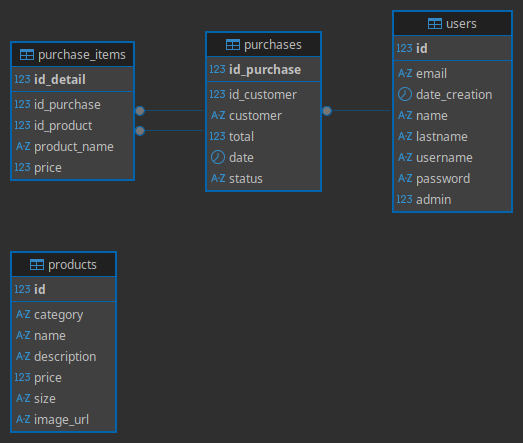

# Arquitectura
- Stacks tecnológicos: 
Lenguajes: HTML, CSS, JavaScript
Librerias y otros: JWT, MariaDB, MySQL2,  
Entorno de Dev: Bun 1.3.14

## Diseño de Bases de Datos
Diagrama hecho con el Software Dbeaver para la facilitar el analisis de llaves foraneas y relaciones entre tablas
